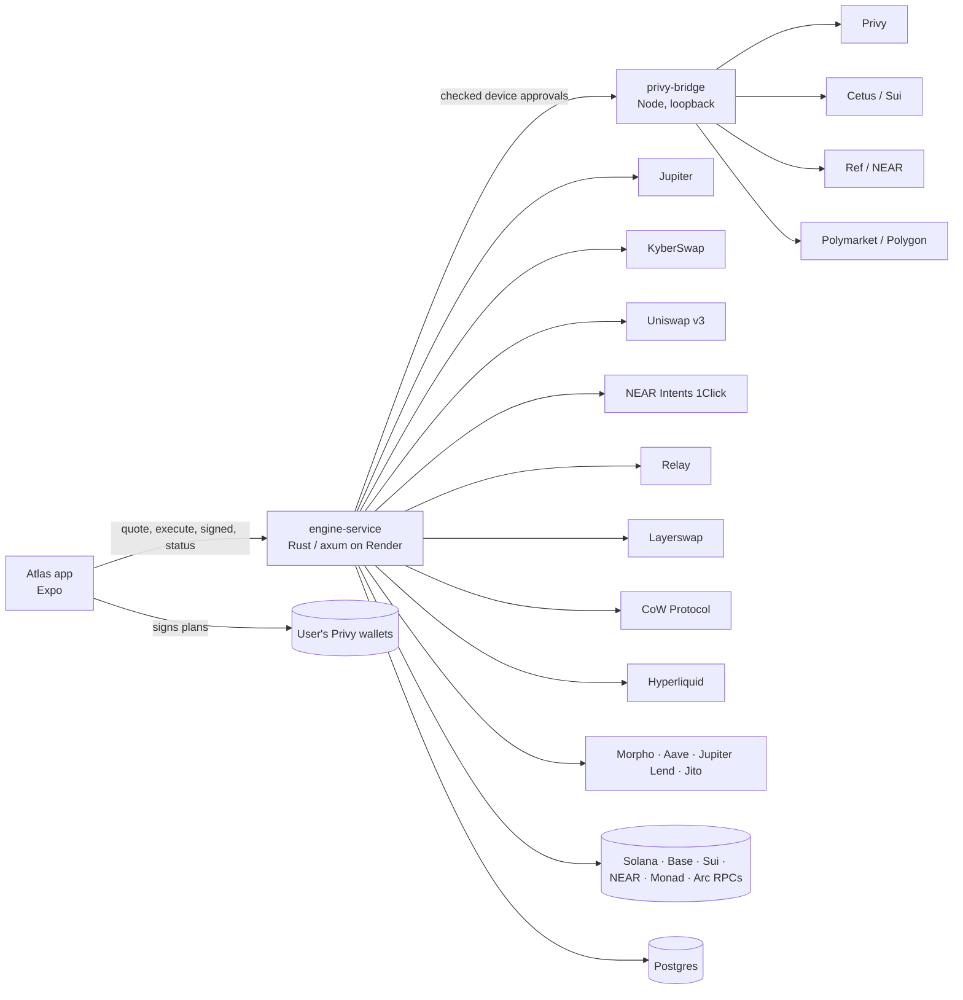

# Atlas Engine

**One balance, every chain, one tap.** Atlas gives people in Nigeria (and anywhere they're paid in a
currency that loses value) one balance in their own money that can buy memes, tokenized stocks and crypto,
open perps, trade predictions, earn yield and pay friends, across Solana, Base, Sui, Monad, NEAR and Arc. This repo is the
engine behind the [Atlas app](https://github.com/Iwetan77/Atlas): it prices everything, plans every action
as bounded transactions and device signatures for the user's **own** wallets, and settles them.

- **API and website:** https://justatlas.xyz (`GET /health` shows the deployed commit and RPC hosts)
- **App:** [Iwetan77/Atlas](https://github.com/Iwetan77/Atlas) (Expo: iOS, Android, web)

Money is shown in the user's selected currency (₦ first). Under the hood, cash is USDC on Solana and Base.
Network details are shown when needed to choose a deposit or withdrawal route.

---

## How it works

1. **Sign in** with Google or email. Privy creates an embedded EVM wallet and a Solana wallet the user owns;
   the engine adds Sui and NEAR receiving wallets under the same login the first time they're needed.
2. **Add money.**
   - USDC on Solana or Base goes straight into the user's own wallet.
   - Other supported coins and networks (USDT on Tron and BNB Chain, USDC on Sui, SOL, BTC, ETH…)
     receive a one-off deposit address from NEAR Intents 1Click. The quote fixes the USDC output and
     shows the total to send. The most used options are flagged `featured`.
   - Bank top-ups create a one-time Nigerian bank account through Daya and deliver USDC to the
     user's Base wallet. The quote shows the requested balance amount, fees and transfer total.
3. **One balance.** `GET /v1/balance` adds up cash on every chain, savings, perps margin and every coin held,
   valued live in the user's currency.
4. **Every action is a quote, then one confirm.**
   - The app asks for a quote; the engine prices it and checks limits and cash, in the user's currency.
   - On confirm it returns an **execution plan**: the exact transactions for the user's wallets, in order.
   - The app signs transactions, checked typed data and one-use device approvals after the one confirmation;
     the engine lands them and reports each stage:
     `validate → fund → sign → execute → settle`.
5. **Unified cash.** If the cash is on the other chain, the plan moves the shortfall first and finishes
   the action once it lands, still behind that one confirm:
   - Base → Solana and Solana → Base through **Relay**, using the quoted shortfall;
   - existing **Layerswap** funding intents remain supported;
   - perps margin into **Hyperliquid** through Relay (gasless from Base, or one Solana transaction).
6. **Gas is never Atlas's.** The user pays from their own USDC, and Privy sponsorship is never used:
   - Solana swaps simulate the user's own transaction first, including fees and account rent.
     If it can pay, Jupiter V2 `/build` is used with no gasless minimum. Otherwise an executable
     Jupiter gasless order is tried. If neither works, cash buys a fee reserve through **Kora +
     NEAR Intents 1Click**, described below. Atlas never funds a fee-payer wallet.
     Plans remain plain transactions (`submit: "engine"`); the phone signs, the engine verifies
     the exact message and signatures, and settlement reads actual on-chain balance changes.
   - Base: supported USDC authorization routes use the venue's relayer. Actions that need the user's
     native gas can prepare a bounded **CoW** USDC → ETH order.
7. **Atlas Links.** Money anyone can claim with a link. The sender's phone makes the link's secret (an EVM
   key) and the plan funds its escrow on Base. The friend opens the link and signs in. Claim preparation
   compares Base and Solana routes and requires the guaranteed USDC output to cover the original gift
   principal. The bridge verifies a payout signed using the secret the claimer holds. The sender can
   reclaim an unclaimed gift; after 30 days only the sender can reclaim it.
8. **Track records.** Every spot fill is kept, so each holding shows its average entry and gain or loss;
   meme cards on Home are made from it. Activity includes deposits, sends, withdrawals, trades and predictions,
   with pending states and transaction IDs. Home shows six recent actions and links to the full history.
   Bank recipient suggestions filter saved recents as the user types an account number.
9. **Predictions.** Polymarket events and outcome shares, paid from the balance. The user's device signs
   and submits venue requests; cash returned to Atlas lands the amount entered, with fees added on top.
10. **Money emails.** Senviok sends event updates to the user's sign-in address, with an opt-out in Profile.

---

## What's integrated

| | What it does in Atlas |
|---|---|
| **Privy** | Sign-in and user-owned wallets. The phone signs transactions, typed data and exact one-use device approvals. The bridge passes approvals to Privy and verifies signatures; it never signs using a user's JWT or an unrestricted server key. |
| **Jupiter** | Solana spot assets (memes, xStocks, crypto), gasless orders, price charts and Jupiter Lend savings. |
| **KyberSwap** | Base swaps: searches every exchange for the best route (router pinned, every built swap decoded and checked: amount in, no fees, pays the user). Any Base token by pasting its address; trending Base coins (GeckoTerminal, CoinGecko-listed only) in Trade. |
| **Uniswap v3** | Base swaps when Kyber can't answer (one direct pool). |
| **NEAR Intents 1Click** | Buys on other chains (Sui, NEAR, Monad…), paid from Base cash or, when Base can't cover it, Solana cash; deposits from supported networks and coins; listed-asset sells and SUI cashouts. |
| **Cetus** | Sui coins 1Click doesn't list (DEEP, WAL…): 1Click delivers SUI, then a device-approved Cetus swap buys the coin. Selling swaps back to SUI before cash-out. |
| **Ref Finance** | NEAR tokens beyond 1Click's list: search, holdings and swaps through Ref pools, signed with one-use device approvals. Pool discovery depends on Ref's indexer. |
| **Polymarket** | Live events, outcome-share buy/sell, resolved claims and exact-output cash return; the phone signs and submits authentication, orders and wallet actions. |
| **Kora** | User-paid USDC transfers for the Solana gas-reserve fallback; Atlas does not sponsor gas. |
| **Daya** | Nigerian bank top-ups and payouts, with quote totals and receipt status. |
| **Relay** | Cash funding between Base and Solana, Hyperliquid funding and Atlas Link payouts. |
| **Layerswap** | Compatibility and settlement tracking for existing cross-chain funding intents. |
| **CoW Protocol** | The Base gas tank: a USDC permit plus a USDC → ETH order, settled by a solver who pays the gas. |
| **Hyperliquid** | Crypto perps and `xyz` stocks, commodities, indices and currencies; Relay margin funding, position open/close, take-profit, stop-loss and candles. The user approves a restricted per-user trading agent; withdrawals require the user's wallet authorization. |
| **Morpho, Aave, Jupiter Lend, Jito** | Earn: Morpho's three largest curated USDC vaults on Base (Gauntlet, Spark, Steakhouse), Aave USDC on Base, Jupiter Lend (USDC, USDT, JupUSD, USDS, EURC), SOL staking. Best rate first. |
| **GeckoTerminal, CoinGecko, DexScreener** | Charts for coins beyond Jupiter; the CoinGecko listing that marks a searched coin verified (exact contract, per chain); Sui search. |
| **Senviok** | Transaction and position emails sent to the sign-in address, with an opt-out in Profile. |
| **Helius** | Solana RPC in production (any keyed RPC works). |
| **Render + Postgres** | Hosting; intents, trades, handles and photos survive restarts. |

---

## Safety model

Atlas plans actions for user-owned wallets. Money-moving requests are checked against the confirmed
owner, amount, recipient and expiry before submission.

- **The user signs.** After one confirmation, the device signs bounded transactions, typed data and
  exact Privy authorization requests. Sui and NEAR requests are prepared once, expire within minutes,
  and can be committed only once. The bridge verifies the owner and confirmed bounds before forwarding
  the device's approval to Privy; no `user_jwts` wallet-signing path remains.
- **Every signed shape stays narrow** (`privy-bridge/base-authorization.mjs`):
  - a USDC `ReceiveWithAuthorization` from the user's wallet to a **pinned** receiver (Relay),
    for exactly the planned amount;
  - a USDC permit to CoW's vault relayer and a CoW order selling USDC for ETH **to the wallet itself**,
    both capped at $2 and two hours;
  - for an Atlas Link, a payout from the link's own escrow to Relay's pinned receiver, signed with the
    secret the claimer holds (the engine never stores it).
- **Venue answers are checked before anything is planned:** deposit contracts, receivers, amounts, chain IDs
  and minimum outputs. A quote that differs from what the user saw is refused.
- **Exact approvals**, never unlimited ones.
- **Persistent progress.** Intent claims and signed reports are persisted in Postgres. Repeated reports
  return the saved status; uncertain submissions are reconciled before another action is prepared.
- **Perps orders** are signed by the user's Hyperliquid agent: derived per user, approved once by the user's
  own wallet inside their first trade's confirm, able to trade and move margin between the user's own
  balances (Hyperliquid's own perps and the `xyz` stock dex), never withdraw or pay anyone else.
- **Perps money back to cash** after a close: the bridge asks Relay for the quote itself, with the user's own
  Solana (or Base) wallet as the recipient, checks every field of the two things the user's wallet signs (Relay's
  nonce mapping, a USDC `sendAsset` of exactly that amount to Relay's Hyperliquid account) and recovers the signer.
- **Unverified coins say so.** A coin found by search is verified only when CoinGecko lists that exact
  contract on its chain; look-alikes keep the warning.
- **Errors are honest:** in the user's currency, and when nothing moved, they say nothing moved.

---

## Architecture



```
crates/engine-service      The HTTP API: balance, markets, trades, perps, earn, friends, deposits, intents.
  src/markets.rs           Catalog, quotes, plans, unified cash, gas tanks, intent state machine.
  src/near_intents.rs      1Click buys, deposits, Sui/NEAR/Monad holdings, charts and verification.
  src/earn.rs              Morpho, Aave, Jupiter Lend, Jito.
  src/hl.rs                Hyperliquid perps: markets, positions, quotes, margin, orders, cash-out.
  src/gasless.rs           Prepares checked device typed-data authorizations and verifies the result.
  privy-bridge/            Node sidecar: token checks, one-use device approvals, signature verification.
crates/engine-execution    Venue clients: jupiter, uniswap, near_intents, relay_link, layerswap, cow,
                           hyperliquid, solana, gateway.
crates/engine-core, engine-types, engine-discovery   Shared types and routing primitives.
```

**Execution lifecycle:** a quote prices the action and checks cash across chains; execute turns it into
an intent with a plan (and, when cash or gas must move first, a funding step); `/signed` lands or relays what
the user signed; the status poll walks the intent through its stages, handing out the second step
(`/next`) once cash or gas has landed; fills are kept as trades for positions.

---

## API

Account and money-action routes need `Authorization: Bearer <Privy access token>`. Public exceptions
include `/health`, cash-link previews, Predictions availability and the served website. Money in and
out is in the user's display currency.

| Method | Route | Purpose |
|---|---|---|
| GET | `/health` | Liveness, deployed commit, RPC hosts |
| GET | `/v1/balance?currency=` | The one balance and its holdings |
| GET | `/v1/assets?category=popular\|crypto\|stocks\|memes&q=` | Trade list (popular = trending) and search, incl. pasted addresses |
| GET | `/v1/assets/{id}/chart?range=1D\|1W\|1M\|1Y` | Price history (spot, 1Click coins and `*-PERP` markets) |
| POST | `/v1/quotes` → `/v1/quotes/{id}/execute` | Buy/sell quote, then its plan |
| GET | `/v1/positions/spot` | Entry, invested, value and gain/loss per holding |
| POST | `/v1/intents/{id}/signed` | What the app signed or sent for a plan |
| GET | `/v1/intents/{id}` | Where an intent stands |
| GET | `/v1/intents/{id}/next` | The second step, once cash or gas has landed |
| GET | `/v1/intents/pending` | Purchases awaiting a device signature or recoverable completion |
| GET | `/v1/transactions` · `/v1/transactions/{id}` | Activity history, receipts and transaction IDs |
| POST | `/v1/onramp/bank/quote` · `/v1/onramp/bank` | Exact balance amount and the fee-inclusive bank transfer total |
| GET | `/v1/onramp/bank/{id}` | Bank top-up status |
| GET | `/v1/predictions/markets` · `/v1/predictions/account` | Events, outcome shares and Predictions cash |
| POST | `/v1/predictions/quotes` → `/v1/predictions/quotes/{id}/execute` | Buy, sell, claim or return cash with one confirmation |
| GET/POST | `/v1/perps/onboarding` | Perps access for the user's wallet |
| GET | `/v1/perps/markets`, `/v1/perps/positions` | Hyperliquid markets (crypto, stocks, commodities, indices, currencies) and open positions |
| POST | `/v1/perps/quotes` → `/execute`, `/v1/perps/positions/{id}/close-quote` → `/v1/perps/close-quotes/{id}/execute` | Open (optionally with `takeProfitPct` / `stopLossPct`, a gain or loss on margin) and close |
| POST | `/v1/perps/positions/{id}/tpsl` `{takeProfitPct, stopLossPct}` | Set or clear (null) a position's take-profit and stop-loss; positions carry `takeProfit` / `stopLoss` `{price, pct}` |
| GET · POST | `/v1/me/emails` · `{enabled}` | Where Atlas emails the user, and turning those emails on or off |
| GET | `/v1/earn/options`, `/v1/earn/positions` | Savings options and what's earning |
| POST | `/v1/earn/quotes` → `/v1/earn/quotes/{id}/execute` | Put in / take out |
| GET/POST | `/v1/me`, `/v1/me/handle`, `/v1/me/avatar`, `/v1/users/resolve` | Profile, @handles, photos |
| GET · POST | `/v1/cashlinks/{escrow}` (public) · `/v1/cashlinks/{escrow}/claim` | An Atlas Link, and claiming it |
| POST | `/v1/sends/quote` → `/v1/sends/quote/{id}/execute` | Send to a friend |
| GET | `/v1/deposit/networks` · POST `/v1/deposit/quote` · GET `/v1/deposit/status` | Deposits from other networks |
| GET · POST | `/v1/predictions/markets/{id}/comments` · POST `/v1/predictions/comments/{id}/delete` | A market's comments (newest first, 30 a page) signed with @handles; posting needs a handle, one line up to 280 characters, no links, one every 15 seconds and 30 an hour; only your own can be deleted |
| GET | `/v1/withdrawals/networks` · POST `/v1/withdrawals/quote` → `/v1/withdrawals/quote/{id}/execute` | Withdraw to a wallet: cash leaves as USDC on Solana or Base, or any deposit coin, sent by 1Click to a pasted address; the amount entered is what the recipient gets, and fees go on top |

Money is represented as `{amount: "<decimal>", currency: "NGN|USD|EUR|GBP|ZAR|KES|GHS"}`.
Quotes provide the reviewed amount and fees; intent responses provide the prepared signing steps
and settlement state. Account and money routes are authenticated; public link previews expose no
wallet signing credentials.

## Run it locally

Requires stable Rust, Node.js 22 or later, npm and Postgres for account and money-action features.
These instructions are for authorized development; see [LICENSE](LICENSE).

```bash
cargo build --locked --workspace
(cd crates/engine-service/privy-bridge && npm ci)
```

Export configuration in the shell before starting each process. The service does not load a local
`.env` file automatically. In one terminal, start the bridge with `PRIVY_APP_ID` and `PRIVY_APP_SECRET` set:

```bash
cd crates/engine-service/privy-bridge
npm start
```

In another terminal, set `DATABASE_URL` and the same server credentials, then start the API:

```bash
PRIVY_BRIDGE_URL=http://127.0.0.1:3101 cargo run -p engine-service
```

The API defaults to `http://127.0.0.1:3000`; the Node bridge listens on loopback port 3101. Database
tables are initialized by the service. Without Postgres, some reads can run with in-memory state,
but persistent account, PIN and money-action features are unavailable.

For local read-only inspection without Privy, replace the example addresses with public wallet
addresses you control:

```bash
ATLAS_DEMO_AUTH_BYPASS=1 ATLAS_TEST_USER_ID=did:privy:demo \
ATLAS_TEST_WALLET_ADDRESS=YOUR_PUBLIC_EVM_ADDRESS \
ATLAS_SOLANA_OWNER_ADDRESS=YOUR_PUBLIC_SOLANA_ADDRESS \
cargo run -p engine-service
```

Demo authentication is restricted to a loopback listener. Do not enable it on a public deployment.

### Configuration

| Variable | Purpose |
|---|---|
| `PRIVY_APP_ID`, `PRIVY_APP_SECRET` | Server-side identity and wallet integration |
| `PRIVY_BRIDGE_URL` | Bare loopback HTTP origin for the Node bridge |
| `DATABASE_URL` | Persistent intents, account data, PINs, receipts, notifications and price alerts |
| `ATLAS_PIN_PEPPER` | Optional stable PIN secret, at least 24 characters; otherwise the Privy secret is used |
| `ATLAS_SOLANA_MAINNET_RPC_URL`, `ATLAS_BASE_MAINNET_RPC_URL` | Mainnet RPC overrides |
| `ATLAS_MONAD_MAINNET_RPC_URL`, `ATLAS_NEAR_MAINNET_RPC_URL`, `ATLAS_ARC_RPC_URL`, `SUI_FULLNODE_URL` | Additional network RPC overrides |
| `JUPITER_API_KEY`, `NEAR_INTENTS_API_KEY`, `RELAY_API_KEY` | Provider credentials where supported |
| `DAYA_API_KEY`, `DAYA_WEBHOOK_SECRET` | Bank integration and verified provider webhooks |
| `ATLAS_FEE_NEAR_ACCOUNT` | Fee recipient required for configured wallet withdrawals |
| `POLYMARKET_BUILDER_API_KEY`, `POLYMARKET_BUILDER_SECRET`, `POLYMARKET_BUILDER_PASSPHRASE` | Prediction trading integration |
| `POLYGON_RPC_URL` | Optional Polygon mainnet RPC override |
| `SENVIOK_API_KEY`, `ATLAS_EMAIL_FROM`, `ATLAS_EMAIL_FROM_NAME` | Transaction email delivery and verified sender |
| `EXPO_PUSH_ACCESS_TOKEN` | Optional Expo push transport access token |
| `HYPERLIQUID_RELAY_URL`, `HYPERLIQUID_RELAY_SECRET` | Optional relay configured with `scripts/hyperliquid-relay.js` |
| `ATLAS_ALLOWED_ORIGINS` | Additional exact browser origins |
| `ATLAS_BALANCE_BIND` | HTTP listen address; defaults to loopback port 3000 |
| `ATLAS_WEB_DIR` | Directory containing the exported Atlas website |

Keep credentials in the deployment's secret configuration. Never put server secrets in the client
or commit them. Choose the PIN pepper before accounts create PINs; changing it requires a controlled
recovery or migration process.

Android push also needs the matching Firebase client configuration and FCM credentials in Expo.
Native iOS needs Apple push credentials; browser delivery needs user permission and platform support.
Browser push keys and queued notifications are persisted in Postgres.

### Checks

```bash
cargo test --locked --workspace
cargo fmt --all -- --check
(cd crates/engine-service/privy-bridge && node --test *.test.mjs)
git diff --check
```

Tests include provider fixtures and mocked boundaries. Ignored provider checks are run separately.
Unit tests and unsigned quotes do not prove funded settlement for every route.

## Deploy

The `Dockerfile` builds the Rust API and packages the Node bridge and exported website.
`scripts/run-render.sh` starts the bridge on loopback, waits for readiness and binds the API to
`PORT` (default 10000).

1. Create a Docker web service from `main`.
2. Configure server credentials, Postgres and the required provider keys.
3. Set `/health` as the health-check path.
4. Allow the website's exact origin in both Privy and `ATLAS_ALLOWED_ORIGINS`.
5. Verify the deployed commit and provider readiness through `/health`.

The website source is [Atlas](https://github.com/Iwetan77/Atlas). Export it with
`EXPO_PUBLIC_ENGINE_URL` and `EXPO_PUBLIC_WEB_URL` set to the deployment origin, replace
`crates/engine-service/web/` with the export, then normalize the static assets:

```bash
python3 scripts/normalize-web-export.py crates/engine-service/web
```

The engine serves public installation guides, short asset and invitation links, and authenticated
account APIs from the same origin. [Android downloads](https://justatlas.xyz/download/android)
resolve to the latest signed release APK. Website deployments do not update installed native apps.

## Operational boundaries

- Receipt success follows confirmed settlement, rather than the submission of a funding transaction.
- Unsupported or unavailable routes are refused before a new spending plan is prepared.
- Market data, exchange rates, network costs, bank settlement and notification delivery depend on providers.
- Prediction trading checks device eligibility; restricted connections cannot trade.
- Price-alert checks and push processing run while the service is active. Free Render services can sleep.
- A returning account must verify its existing payment PIN. PIN changes require the current PIN;
  ordinary login does not provide a forgotten-PIN reset.

## License

Proprietary. Copyright © 2026 Atlas. All rights reserved. Source is publicly viewable for evaluation,
demonstration and reference only. Use, copying, modification, distribution and deployment require
prior written permission. See [LICENSE](LICENSE). Third-party dependencies and bundled Inter fonts
retain their own licenses, including the [SIL Open Font License](crates/engine-service/assets/social/LICENSE_FONT).
